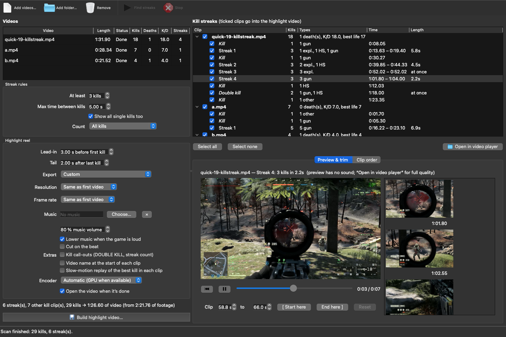
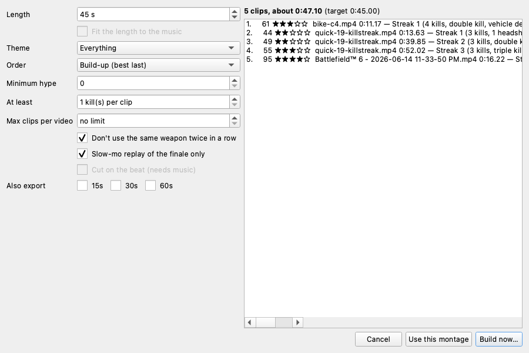

# BF6 Kill Tracker

Finds every kill and death in Battlefield 6 gameplay recordings, flags kill streaks, and turns them into a finished highlight video. It reads two things on screen: the kill skulls that pop up under the crosshair, and the kill feed in the top right. Runs on Windows, macOS and Linux.

```
bike-c4.mp4
  duration 0:21.52  |  4 kills  |  1 death(s), K/D 4.0  |  1 streak(s)  |  processed in 8.3s
  kill types: 3 gun, 1 explosive
  most kills in one life: 4
  timeline:
    0:11.17  (explosive)  [streak 1]
    0:14.22  (gun)  [streak 1]
    0:16.13 x2  (gun, gun)  [streak 1]
    0:19.30  -- died --
```

## Desktop app



1. **Add videos.** Use **Add videos…** or **Add folder…**, or drag files onto the window.
   - **Watch folder…** automatically adds and scans new recordings saved to your Battlefield or ShadowPlay folder.
2. **Scan.** Click **Find streaks**. Each video is scanned in the background, at low priority so you can keep playing.
   - The list shows kills, deaths, K/D and streaks for each video.
   - Scans are remembered, so reopening a video is instant.
3. **Check the results.** Every clip gets kill types (headshot, gun, explosive) and a **hype score** (★).
   - The score counts multi-kills, headshots, explosives, fast kills, LAST SQUAD MEMBER ALIVE, squad wipes and medals.
   - **Show all single kills too** also lists kills outside streaks.
   - Streak rules (minimum kills, time between kills, which kill types count) regroup the list instantly. A death always ends a streak.
4. **Fix mistakes.** **Review…** steps through every detection: ✓ / ✗, fix the kill count, or add a missed kill or death at the preview time.
   - Gunfire with no detected kill is suggested as a possible miss.
   - Corrections are kept and applied to every future scan.
5. **Preview and trim.** Click a clip to play it in the preview box: low resolution, no sound, starts instantly.
   - The **timeline** under it shows the audio waveform, kill and death markers, and every clip. Drag a clip's edges to trim it; the wheel zooms.
   - **Open in video player** plays the clip at full quality, with sound.
6. **Order the clips.** Use the **Clip order** tab, or **Make montage…** (below).
7. **Build.** Click **Build highlight video…**. Options:
   - **Export preset:** YouTube 1440p60 / 1080p60, Vertical 9:16, Discord under 25 MB, or GIF.
   - **Music:** volume, dip under loud game audio, and cut on the beat.
   - **Call-outs:** DOUBLE KILL, 4 KILL STREAK… **Style…** sets position, font, colours and wording.
   - **Effects & branding…:**
     - transitions (fade, cut, crossfade, whip, zoom);
     - kill-cam zoom on each kill and shake on headshots;
     - captions per kill (HEADSHOT · RIFLE);
     - intro and outro cards, and a text or logo watermark;
     - game-audio track choice, noise reduction, and loudness levelling;
     - an automatic YouTube thumbnail;
     - **look:** colour grade (Vivid, Warm, Cool, Teal & orange, Cinematic, Black & white, Sepia, Vintage, Neon, Night vision, Deep fried), cinema bars, vignette, film grain;
     - **templates** (20): Clean, Montage, Cinematic, Esports, Sniper elite, Teal & orange, Retro VHS, Noir, Night ops, Neon, Chill, Deep fried, TikTok hype, Funny moments, and six MLG looks (MLG, MLG lite, MLG MAX, MLG 360 no scope, MLG sounds only, MLG TikTok). You can also save your own;
     - **▶ Preview this look:** renders a few seconds with the current settings and plays them with sound in your video player. It uses the selected clip, or a made-up demo clip with a kill, a headshot, a triple and a C4 double kill;
     - **MLG mode** (below).
   - **Extras:** slow-motion replay of the best kill, clip titles, GPU encoding on Windows.
8. **Export markers…** writes kills, deaths and streaks as markers for DaVinci Resolve / Premiere (EDL), Final Cut / Resolve (FCPXML) or Premiere (XML), or as YouTube chapter timestamps.
9. **Save your work.** **Save project…** / **Open project…** keep your videos, ticks, trims, order and settings.
10. **See your stats.**
    - **Players** lists the opponents you killed most and who killed you, matched by name in the kill feed.
    - **Library & stats** shows every session: best streaks, K/D, kills per hour and headshot rate.

### Montage builder



**Make montage…** picks clips for you and shows the list as you change the settings:
- **Length:** a fixed length, or the length of your song.
- **Theme:** everything, headshots, explosives, multi-kills, or clutch moments.
- **Filters:** minimum hype, minimum kills per clip, and a maximum number of clips per video.
- **No repeat weapon:** don't use the same weapon twice in a row.
- **Order:** build-up (best last, second-best first), best first, chronological, alternate big and small, or shuffle.
- **Finale replay:** a slow-motion replay of the last clip only.
- **Cut on the beat.**
- **Also export** 15, 30 and 60-second versions in the same run.

### MLG mode

The 2014 "MLG montage" parody look. Turn it on with the **MLG** template, the tick box in **Make montage…**, or **Effects & branding… → MLG mode**.
- **Every kill:** a hitmarker with a tick sound, an air horn (picture and BWAAA), flying Mountain Dew cans and nacho chips, meme text ("OH", "WOW", "GET REKT"…) and a colour strobe.
  - **Headshots:** a sniper scope snaps on just before the kill.
  - **Explosive kills and multi-kills:** a fireball with a boom and screen shake.
- **Multi-kills:** money rain and a dubstep wub.
- **3 kills within 4 s (or a x3 multi-kill):** "OH BABY A TRIPLE" (voice and text), a screen of scrolling "OHHHHHH", a 360 spin, a hitmarker flood, the illuminati, pixel shades dropping in, deep-fried colours and bass-boosted audio.
- **MLG settings…** has 20 on/off switches, including optional voice lines ("wow", "get rekt"…), rainbow smoke and a siren. It also has:
  - **Chaos:** mild, normal or max.
  - **Strobe:** off, colour only, colour plus a flash on kills, or maximum. Maximum flashes rapidly; don't use it if you or your viewers are sensitive to flashing images.
  - **Deep-fry:** off, on triples, or on every kill.
  - **Air horn chance** (share of single kills that get a horn), **sound effects volume**, your own **meme words** and **triple text**, and **layout #** to reshuffle the random placement.
  - **▶ Listen** buttons for every sound, and **▶ Preview MLG**.
- **Sounds and pictures:**
  - The air horn is a real recording of a stadium gas horn (CC0, from BigSoundBank), cut into the BWAAA-BWA-BWA-BWAAAA rhythm.
  - The cans and the flying logo use the real Mtn Dew logo, from Wikimedia Commons, where it's public domain as a text logo. Mtn Dew is a PepsiCo trademark, and this project isn't affiliated with PepsiCo.
  - The triple line uses your computer's built-in voice: Windows speech or macOS `say`; on Linux, `espeak` if installed. To use the original meme clip, or any other sound, choose it under **Triple sound** / **Air horn sound**. The original meme clips aren't included because they're copyrighted.
  - Sources are listed in `bf6killtracker/templates/mlg/SOURCES.txt`.
- **Meme sound pack:** 16 classic clips (Oh baby a triple, MLG air horn and hitmarker, FBI OPEN UP, Sandstorm…).
  - They download automatically from myinstants.com the first time you open **MLG settings…** or build an MLG video, about 1.5 MB. **Download meme sounds** retries any that failed; offline, the built-in sounds are used.
  - From the command line: `python -m bf6killtracker sounds`.
  - They aren't shipped in the app or the repository because most are copyrighted; Sandstorm, for example, is a commercial song.
  - Each file is checked against a SHA-256 checksum before it's saved.
- **Your sounds folder:** the pack lands here, and you can replace any clip with your own by using the same name. **MLG settings… → Open my sounds folder** opens it.
  - Windows: `%LOCALAPPDATA%\bf6killtracker\sounds`; macOS: `~/Library/Caches/bf6killtracker/sounds`; Linux: `~/.cache/bf6killtracker/sounds`.
  - Python from the Microsoft Store: `%USERPROFILE%\BF6KillTracker\sounds`. Windows hides files that Store apps write into AppData from other programs, including ffmpeg, so the app keeps sounds and temporary files there instead.
  - Name each file after its slot (`.mp3`, `.wav`, `.m4a`, `.ogg`… all work). Silence at the start is trimmed, and long clips fade out.

  | File | When it plays |
  |---|---|
  | `triple` | "OH BABY A TRIPLE" on 3 kills in 4 s |
  | `dotatriple` | Announcer "TRIPLE KILL!" just before it |
  | `airhorn` | Replaces the built-in air horn |
  | `hit` | Replaces the hitmarker tick |
  | `explosion` | Explosive kills and multi-kills |
  | `headshot`, `wow` | Headshots (the headshot voice, then the anime "wow") |
  | `what` | Multi-kills at once, e.g. a C4 double |
  | `omgwow` | A quick follow-up kill (within 3 s) |
  | `money` | With the money rain |
  | `mtndew` | "I'm talking about Mountain Dew baby" with the flying logo |
  | `boompow` | The finishing kill of a clip with 3+ kills |
  | `fbi` | 4+ kills in 6 s, with a door-breach shake on the shout |
  | `pwnage` | Intro sting at the very start |
  | `sandstorm`, `sandstorm_flute` | Background music, chosen under **MLG music** or with `--mlg-music` (MLG MAX picks Sandstorm). It loops and only plays when no other music is chosen. |

  Each slot has its own switch and ▶ Listen button in MLG settings. Listen plays inside the app: Windows' built-in player, or `afplay` on macOS.

The app checks GitHub for new releases at start-up.

## Install

**Windows, no Python needed:**
1. Download `BF6KillTracker-windows.zip` from the repository's Releases page. Every commit's build is also available from the Actions tab, under *windows-build*.
2. Unzip it.
3. Run `BF6KillTracker.exe`. The same exe also takes the command-line arguments shown below.

**From source (any OS):** you need Python 3.9 or newer; 3.9, 3.12, 3.14 and 3.15 are tested. ffmpeg is bundled through `imageio-ffmpeg`.
- Windows: double-click `bf6killtracker.bat`.
- macOS / Linux: double-click `BF6 Kill Tracker.command`.

Both launchers install everything on first run, and again whenever `requirements.txt` changes. To set it up by hand:

```sh
python3 -m venv .venv
.venv/bin/pip install -r requirements.txt
.venv/bin/python -m bf6killtracker            # opens the app
```

## Command line

```sh
python -m bf6killtracker analyze VIDEO_OR_FOLDER [more ...] [options]
```

| Option | Meaning |
|---|---|
| `--json FILE` / `--csv FILE` | Save results. The CSV has one row per kill or death, with types and weapons. |
| `--reel FILE.mp4` | Join every streak from all inputs into one highlight video (`.gif` for a GIF). |
| `--preset NAME` | Export preset, e.g. `"YouTube 1080p60"` or `"Discord (under 25 MB)"`. |
| `--music FILE --beat-sync` | Add background music, optionally cutting on the beat. |
| `--montage 60` | With `--reel`: auto-pick the best clips for about 60 s. Also `--montage-theme Headshots`, `--montage-order "Best first"`, `--montage-per-video 2`, `--montage-no-repeat-weapon`, `--montage-fit-music`, `--replay-finale`. |
| `--template Montage` | A ready-made look; one of the 20 templates above (e.g. Cinematic, Noir, "MLG MAX"). |
| `--mlg` | MLG mode. Also `--mlg-intensity max`, `--mlg-strobe light`, `--mlg-deepfry always`, `--mlg-on voices,smoke` / `--mlg-off cans,spin` (any of the 20 elements), `--mlg-words "GG,EZ"`, `--mlg-sfx-volume 1.5`, `--mlg-airhorn-chance 0.5`, `--triple-sound FILE`, `--airhorn-sound FILE`. |
| `--grade Cinematic --letterbox --vignette --grain` | Colour grade and film look. |
| `--transition whip --killcam both --captions` | Transitions, kill-cam zoom/shake, kill captions. |
| `--intro-text CAMx --outro-text "Thanks for watching" --watermark-text @CAMx` | Cards and watermark (`--watermark-image logo.png`). |
| `--audio-track 2 --denoise --loudnorm --thumbnail thumb.jpg` | Audio options and a YouTube thumbnail. |
| `--markers edl fcpxml premiere chapters csv` | Editor markers (next to each video, or `--markers-dir DIR`). |
| `--low-priority` | Scan at low CPU priority. |
| `--overlays --titles --replay` | Kill call-outs, clip titles, slow-mo replays. |
| `--callout-pos "Lower third"` / `--callout-xy 0.75 0.6` | Where call-outs appear: a named position, or a centre point as fractions of the frame. |
| `--callout-size 140 --callout-font FILE` | Call-out size (% of default) and font file. |
| `--callout-color ffd700 --callout-accent none` | Text colour and accent bar colour (or `none`). |
| `--callout-text "KILL" "{n} IN A ROW" "{name}!"` | Wording for first kill, streak and multi-kill. |
| `--callout-style FILE.json` | A full style (same fields as in a project file's `callout_style`). |
| `--max-mb N`, `--encoder NAME` | File-size limit; encoder choice. |
| `--clips DIR` | Also export each streak as a separate clip. |
| `--streak-gap 5 --streak-min 3` | What counts as a streak. |
| `--streak-type headshot` | Only count these kill types toward streaks. |
| `--rescan`, `--no-feed` | Ignore remembered scans; skip the kill feed (faster, but no deaths or kill types). |
| `--hud-scale 0.9` | Force a HUD scale. Normally detected automatically. |

`calibrate clip.mp4 --at 52.5` writes a PNG showing where the detector looks.

To try a look without a full render: `python -m bf6killtracker preview out.mp4 --template "MLG MAX"`. This renders a few seconds of the demo clip; add `--video FILE --start 50 --kills 52:3` to use your own recording.

## How it works

1. **Auto-calibration.** A few keyframes are searched for skulls at several sizes, which sets the HUD scale and position, including for ultrawide recordings.
2. **One decode pass.** A single ffmpeg pass decodes only small screen regions, processed in parallel:
   - the kill notification;
   - the kill feed;
   - the label strips (KILL, SQUAD REVIVE, medals, LAST SQUAD MEMBER ALIVE);
   - the MAN DOWN screen;
   - the scoreboard header.
3. **Skulls.** Matched against white and red skull templates, with checks that reject look-alike icons.
4. **Kill feed.** Rows with your "▸" marker give kills, with weapon and headshot. Rows with the marker on the victim side are deaths. A red XX row is a squad wipe. Each row also stores a picture of the other player's name, used for the Players view.
5. **Other screens.**
   - **MAN DOWN** gives a second source for deaths, plus time spent down.
   - **Scoreboard:** your row's score and K/D/A are read with digit templates, giving the game's own numbers.
6. **Audio.** Tested as a kill signal: BF6's kill sound isn't distinctive enough. Bursts of gunfire are used only for "possible missed kill" hints in review.
7. **Streaks, lives and hype** are computed from all of the above, then your review corrections are applied.

Templates live in `bf6killtracker/templates/`. Add a cropped icon there to teach the tracker a new weapon (`weapons/`) or label (`labels/`). Unknown weapons show as `other`.

## Accuracy

All results below were checked by hand against the skulls and the kill feed.

| Clip | Kills | Deaths | Kill types | Notes |
|---|---|---|---|---|
| `quick-19-killstreak.mp4` (1:32) | 18 | 1 | 7 gun, 6 explosive, 4 headshot, 1 other | |
| `Battlefield 6 - 2026-06-14 …` (0:28) | 7 | 0 | correct | Includes a 4-kill burst and a squad revive, which is not counted. |
| `bike-c4.mp4` (0:22) | 4 | 1 | correct | C4 tank kill, kills over yellow flowers, then a death. |

The scoreboards in these clips were read correctly: score 14,755, K/D/A 66/20/31; and score 4,015, K/D/A 13/6/10. Medals, revives, vehicle and equipment kills, and LAST SQUAD MEMBER ALIVE were all detected.

Not done:
- **Map name:** none of these clips include a loading screen to learn it from.
- **Machine-learning model:** waits on labelled data from review mode, which you can export with `review.export_dataset()`.

Re-encodes at 30 fps, at 1080p, at HUD scale 0.85 and at ultrawide 3440×1440 gave the same kills.

Detection still depends on the default kill-feed and HUD colours. Colour-blind modes may need new templates.

## Tests

```sh
python -m pytest -q
```

Unit, reel, GUI (headless Qt), kill-feed, calibration and workflow tests use generated data and run in CI on Windows, macOS and Linux. The end-to-end tests run on the reference clips when they're in `~/Downloads`.
